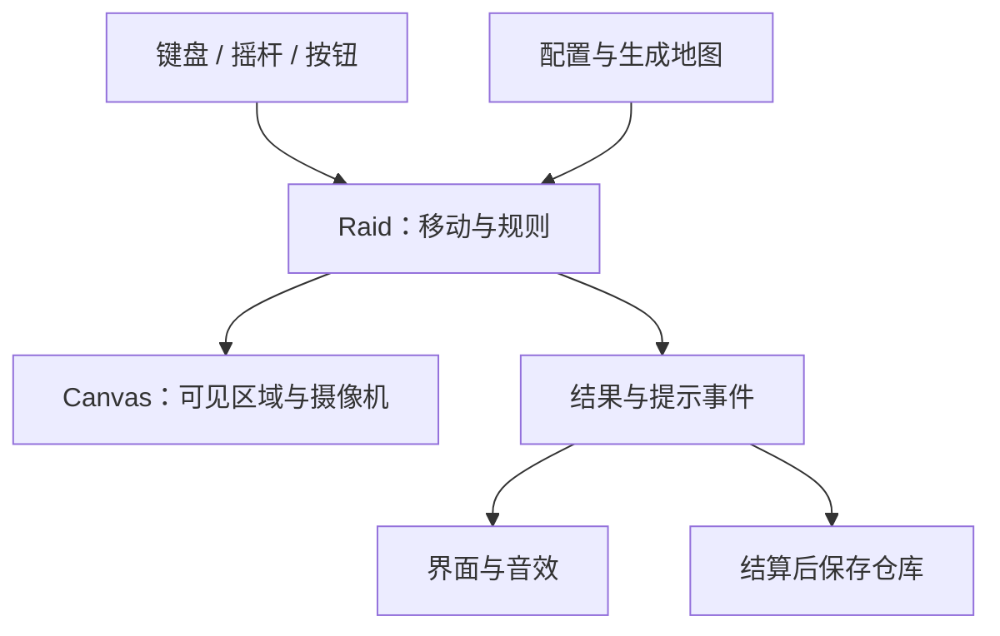
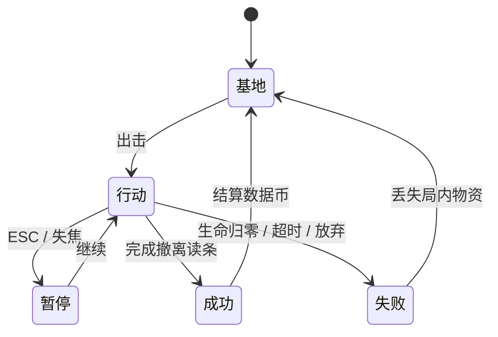

# 技术架构与学习路径 · v0.9

## 1. 总体结构

这是原生 HTML + CSS + JavaScript ES modules 项目。浏览器加载 `dist/index.html`，由 `src/main.js` 组装模块。网页版不需要 npm 安装，也没有外部字体、图片、音频依赖。v0.8桌面打包使用锁定的Electron开发依赖，将同一游戏代码和运行时打包为EXE，详见 [桌面架构](DESKTOP_V08.md)。音效由 Web Audio 合成，默认关闭。

| 文件 | 职责 | 适合你关注的原理 |
|---|---|---|
| `dist/index.html` | 界面、Canvas 容器、按钮、弹窗结构 | HTML 与游戏逻辑的关系 |
| `dist/style.css`、`tactical.css`、`bright.css` | 基础布局、HUD页签、白底/彩色主题覆盖 | 作用域变量与响应式布局 |
| `src/number-tiles.js` | Canvas立体数字皮肤与首页共享配色 | 展示数据复用、不改变碰撞体 |
| `src/config.js` | 全部核心平衡参数与资源定义 | 常量、数据驱动配置 |
| `src/equipment.js` | 二十类武器、十二种附魔、六档品质、护甲吸收、装备价值 | 数据建模、组合与边界规则 |
| `src/shelter.js` | 设施成本、解锁、初始装备、奖励与材料 | 局外经济与原子操作 |
| `src/spatial.js` | 障碍/地表网格、增量插入与局部查询 | 空间索引、查询与几何分离 |
| `src/art.js` | SVG 图标和庇护所插画 | 本地矢量图形与数据驱动展示 |
| `src/math.js` | 距离、碰撞、视线、伤害公式、随机种子 | 函数、向量、几何 |
| `src/regions.js` | 七巧板/放射/BSP/Voronoi分区、风险、点归属与抽样 | 多边形铺图、射线法与拒绝采样 |
| `src/pressure.js` | 安全落点、预警、波次、围攻与活跃预算 | 时间驱动状态机与压力控制 |
| `src/navigation.js` | 局部反向寻路场、可通行缓存 | 广度优先搜索与共享路径 |
| `src/landscapes.js` | 六种地标布局、河道桥梁与多种地表 | 程序关卡、地形优先级、内容密度 |
| `src/world.js` | 地图生成、敌人和掉落的数据结构 | 对象、数组、生成约束 |
| `src/enchantments.js` | 十二种附魔、持续状态、减速与触发限频 | 二次伤害边界、状态持续时间 |
| `src/bosses.js` | 三种首领、招式循环、半血阶段 | 多阶段状态机与预警 |
| `src/commerce.js` | 商人库存、背包物资扣款和购买 | 交易原子性、前置校验 |
| `src/game.js` | Raid 状态、移动、合成、战斗、交互与结算 | 游戏状态机与确定步长 |
| `src/input.js` | 键盘、鼠标、触屏输入 | 事件与按住/单次触发 |
| `src/renderer.js` | 摄像机、地图、方块、墨迹/特效、小地图 | 坐标变换与 Canvas 绘制 |
| `src/ui.js` | 独立庇护所、出击准备、HUD 和弹窗 | 视图与业务状态分离 |
| `src/save-transfer.js` | JSON校验、导出和导入前备份 | 数据边界、可恢复迁移 |
| `desktop/*.cjs` | Electron入口、协议、预加载桥和原生启动检查 | 桌面进程隔离与固定来源 |
| `src/storage.js` | 新旧存档迁移、校验与结算 | 序列化、边界校验、幂等 |
| `src/audio.js` | 可关闭的武器/命中合成音效、事件限频 | Web Audio 包络、噪声与资源复用 |
| `src/main.js` | 启动模块、主循环、暂停和事件分发 | 模块协作与依赖方向 |

`Raid` 不操作 DOM，也不访问 localStorage。因此 Node 能直接导入它运行逻辑测试，渲染器以后也可以更换。

## 2. 输入、模拟、显示如何协作

每帧先读取按键，再让 `Raid.update()` 按固定步长推进游戏状态。模拟产生“合成了”“受伤了”“行动结束了”等事件；主入口把事件交给界面和音效。最后，渲染器读取当前状态画一帧。



按住空格和 E 是持续状态；Q、R、G、F、武器槽和 Shift 是按下沿，只在从“没按”变为“按下”时触发，防止长按 Q 一瞬间把道具耗光。失焦时清空输入并暂停，避免松键事件丢失后角色不停走。

## 3. 固定时间步长

模拟以 `1/60` 秒为一步。主循环使用 `requestAnimationFrame()` 请求浏览器绘制，将两帧间隔积累起来：

```js
accumulator += dt;
while (accumulator >= 1 / 60) {
  raid.update(1 / 60, input.consume());
  accumulator -= 1 / 60;
}
renderer.draw(raid);
```

位移公式为 `位移 = 速度 × dt`，所以不会简单地写成“每画一帧移动 5 像素”。对角输入需要归一化，否则同时按右和下会快约 1.414 倍。

本版将单次补偿间隔上限设为 0.1 秒，避免页面卡顿之后突然瞬移或补算大量敌人攻击。代价是持续极低帧率下模拟会变慢；性能验收需要真机测试，不能把固定步长当作性能保证。后台/失焦通过显式暂停处理。

## 4. 世界坐标和屏幕坐标

玩家的 `(x,y)` 使用本局 `world.bounds`：最低 6400 × 4000，最高 12800 × 8000。7–12块多边形拼满地图，`zoneAt({x,y}, sectors)` 用点归属查询所在拼块。`sectorId` 表示形状编号，`zone` 表示风险等级，避免形状编号与三档掉落混淆。不能用全局最低尺寸限制高难度的移动、弹丸或摄像机。摄像机记录正在看哪里，绘图时整体变换：

`屏幕位置 = (世界位置 − 摄像机位置) × 显示比例 + 屏幕中心`

鼠标和触屏面板的像素坐标不能直接当作地图坐标。`screenToWorld()` 反转相机平移和缩放得到鼠标瞄准点；CSS 像素只转换一次，不重复乘设备像素比。触控攻击提供辅助瞄准。涂鸦配色使用独立展示数据 `PAINT`。地面墨迹按当前可见网格与地图种子做无状态哈希，只画可见区域，不改变地图实体、随机数流或碰撞。

Canvas 按设备像素比建立后备画布，上限为 2，以兼顾清晰度和开销。

碰撞半径与视觉特效分开：光晕不影响碰撞，成长也不扩大身体。障碍使用矩形，实体使用圆；圆与矩形碰撞用“找到矩形上最近点，再比较距离”计算。

命中事件携带武器、方向和强度，驱动镜头与音效；模拟保存短暂闪白、后坐、击退和碎片。击退仍走 `moveEntity` 碰撞流程。重击停顿不超过两个固定步且限频，期间缓冲单次操作；恢复时消费一次，避免丢键。音效复用上下文/噪声缓冲并限频，展示用噪声不消耗战斗的种子随机数。详细规则见 [v0.6 拼块与打击反馈](TANGRAM_V06.md)。

## 5. 为什么闪避不穿墙

如果只检测一次大位移的终点，角色可能从墙前直接跳到墙后，两个点都不在墙内，却穿过了墙。`moveEntity()` 会将位移拆成小于半径一半的片段，分别测试 X 与 Y，碰墙时仍可沿墙滑动。

`SpatialGrid` 在生成后索引静态障碍；移动和线段按包围盒查询附近候选，再执行精确几何判定。它减少扫描数量，不改变碰撞规则。更改障碍数组或长度时回退全扫描；当前障碍本身不动态移动。

地表也建立空间索引，模拟查询实体脚下的地表，渲染只取可见范围。桥面优先于水面，粗糙地面优先于公路；纯路面和冰原可以加速。

攻击、÷2 和弹丸还有线段与矩形的视线判定。攻击不允许隔墙命中。AI 暂时只有直线追击与局部巡逻，使用局部共享寻路场绕障，并用空间网格做群体避让；完整导航网格和全局最短路尚未实现。

## 6. 游戏和敌人的状态



敌人使用 `idle`（空闲/追击）、`windup`（蓄力）、`charge`（冲锋）、`burst`（定时连射），独立 `stun` 计时器和 `dead` 标记。v0.7 另有守卫返回标记、首领 `boss-charge` 状态及招式/阶段计数。距离玩家 1800 以外且未在执行攻击的敌人跳过活跃 AI。攻击开始时记录目标位置，读条结束后攻击那个位置，给玩家可预期的躲避机会。

## 7. 存档和结算

当前存档键为 `number-extraction-v09`，数据结构版本为 3，包含余额、合金/核心、四类设施等级、打造记录、所选难度/武器/地图/附魔、最高数字与最近 6 局记录。不保存进行中的地图。

没有新键时优先读取 v0.7/v0.8 的 `number-extraction-v07`，然后依次尝试 `number-extraction-v03` 与 `number-extraction-v01`，保留旧版余额/历史并映射已有升级，然后立即写入新键，旧键不修改。之后旧版游玩只会改变旧键，不能覆盖新进度。选择出击设置、设施升级、打造与行动结算后保存。打造记录只接受已知武器、1–5级和白名单附魔；品质由等级重算，不能从损坏存档注入任意品质。

两层保护避免重复入账：`Raid.finish()` 已有结果时立即返回；`settleRun()` 遇到近期已结算的行动 ID 不会再次加钱。此处幂等防止同一会话重复事件；它不是服务端金融账本，也不是跨窗口并发防护。本版应在同一个标签页中游玩，多个标签页的本地进度可能互相覆盖。

读取时校验版本、数值上下限和数组结构，损坏的 JSON 回退到新存档。存储权限被禁用时，游戏降级为会话内运行并显示提示，不直接崩溃。没有加密、云同步或防作弊；单机客户端数据可修改是当前预期。

v0.7 的资源点生成、有限增援、永久打造、局内交易、安全屋与首领门禁见 [新规则](STRONGHOLDS_V07.md)。弹反在输入层取按下沿，在模拟层检查时间窗口与朝向；反射弹丸在同一模拟步终止旧弹道处理，避免反射后仍伤害玩家。

v0.9 的新武器、附魔状态和独立存档迁移见 [亮色军械库](BRIGHT_V09.md)。持续伤害保存施加时的数字/品质快照；同类状态刷新持续时间而不无限叠加，二次伤害不再递归触发附魔。重力移动仍使用碰撞流程。

## 8. 第一课：自己改一个有意义的参数

你已经有一些 Python/C 基础，可以按下面的顺序读和改，不必先学完所有前端知识。

1. 先运行游戏，记录初始移动速度和第一次撤离体验。
2. 在 VS Code 打开 `dist/src/config.js`，找到 `speed: 215`。
3. 改为 `speed: 270`，保存后刷新页面，观察躲避和探索是否变得太容易。
4. 在 `math.js` 找到 `damageFraction()`。白色武器、无护甲时手算：4 打 16 为目标最大生命的 12.5%，16 打 4 为 75%。
5. 看 `game.js` 的 `divide()` 如何将敌人减半，并保留其剩余生命比例。
6. 运行测试。先理解已有测试的输入、操作、预期结果，不要为了“全绿”直接改断言。

用一句话解释三个问题，就完成第一课：

- 为什么同样是“数字 4”，中立块和活着的敌人不能用同一条碰撞规则？
- 如果把速度写成“每帧 5 像素”，不同刷新率的电脑会怎样？
- 为什么战利品不能在拾取时就直接加到永久仓库余额里？

v0.5 怪潮、局部寻路和撤离解锁见 [压力规则](PRESSURE_V05.md)。v0.4 新增地形、敌人和武器的规则见 [扩展规则](EXPANSION_V04.md)。v0.3 已加入独立庇护所、难度、大地图、过载与运算节点，详见 [远征规则](SHELTER_V03.md)。战斗基础见 [v0.2 规则](COMBAT_V02.md)。后续可继续研究主动选择 ÷2 目标或更好的绕墙寻路。

## 9. 官方技术参考

- [MDN：JavaScript modules](https://developer.mozilla.org/en-US/docs/Web/JavaScript/Guide/Modules)：模块通过 HTTP 服务加载，本地直接 file:// 打开可能受安全限制。
- [MDN：requestAnimationFrame](https://developer.mozilla.org/en-US/docs/Web/API/Window/requestAnimationFrame)：与浏览器绘制协作的动画回调。
- [MDN：localStorage](https://developer.mozilla.org/en-US/docs/Web/API/Window/localStorage)：按来源保存浏览器数据，可能因权限策略抛出异常。

项目没有采用外部游戏框架；这些链接用于解释实现原理，不意味着必须依赖某个第三方服务才能游玩。
