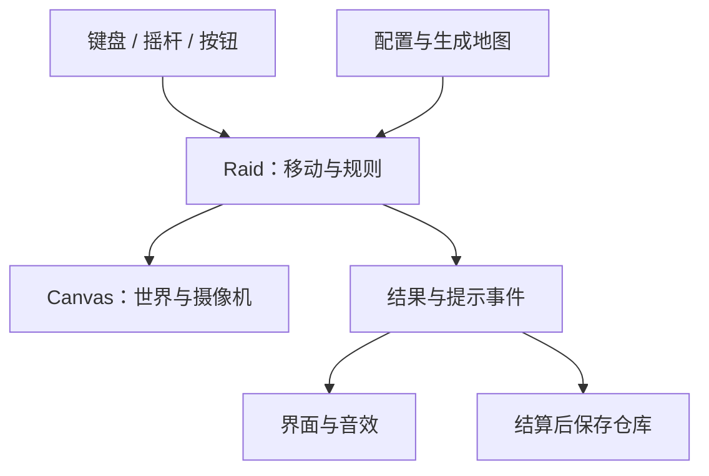
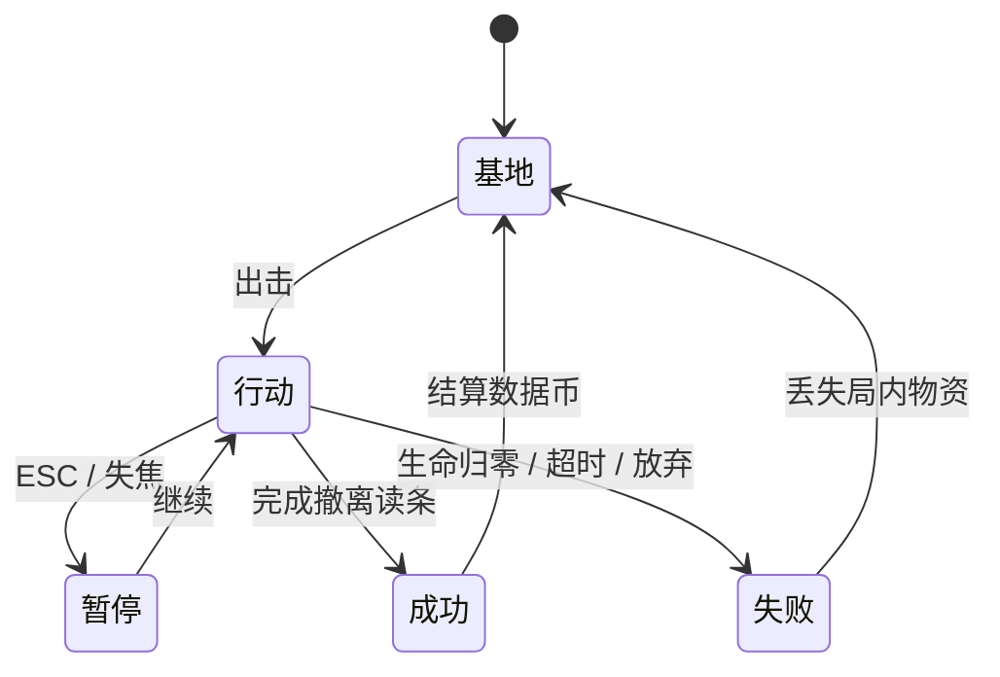

# 技术架构与学习路径 · v0.2

## 1. 总体结构

这是原生 HTML + CSS + JavaScript ES modules 项目。浏览器加载 `dist/index.html`，由 `src/main.js` 组装模块。不需要 npm 安装，也没有外部字体、图片、音频依赖。音效由 Web Audio 合成，默认关闭。

| 文件 | 职责 | 适合你关注的原理 |
|---|---|---|
| `dist/index.html` | 界面、Canvas 容器、按钮、弹窗结构 | HTML 与游戏逻辑的关系 |
| `dist/style.css` | 桌面与触屏布局、色彩、排版 | CSS 响应式布局 |
| `src/config.js` | 全部核心平衡参数与资源定义 | 常量、数据驱动配置 |
| `src/equipment.js` | 六类武器、六档品质、护甲吸收、装备价值 | 数据建模、组合与边界规则 |
| `src/math.js` | 距离、碰撞、视线、伤害公式、随机种子 | 函数、向量、几何 |
| `src/world.js` | 地图生成、敌人和掉落的数据结构 | 对象、数组、生成约束 |
| `src/game.js` | Raid 状态、移动、合成、战斗、交互与结算 | 游戏状态机与确定步长 |
| `src/input.js` | 键盘、鼠标、触屏输入 | 事件与按住/单次触发 |
| `src/renderer.js` | 摄像机、地图、方块、特效、小地图 | 坐标变换与 Canvas 绘制 |
| `src/ui.js` | HUD 更新、规则/仓库/结果界面 | 视图与业务状态分离 |
| `src/storage.js` | 存档校验、结算、基地购买 | 序列化、边界校验、幂等 |
| `src/audio.js` | 可关闭的合成音效 | Web Audio 基础 |
| `src/main.js` | 启动模块、主循环、暂停和事件分发 | 模块协作与依赖方向 |

`Raid` 不操作 DOM，也不访问 localStorage。因此 Node 能直接导入它运行逻辑测试，渲染器以后也可以更换。

## 2. 输入、模拟、显示如何协作

每帧先读取按键，再让 `Raid.update()` 按固定步长推进游戏状态。模拟产生“合成了”“受伤了”“行动结束了”等事件；主入口把事件交给界面和音效。最后，渲染器读取当前状态画一帧。



按住空格和 E 是持续状态；Q、R、Shift 是按下沿，只在从“没按”变为“按下”时触发，防止长按 Q 一瞬间把道具耗光。失焦时清空输入并暂停，避免松键事件丢失后角色不停走。

## 3. 固定时间步长

模拟以 `1/60` 秒为一步。主循环使用 `requestAnimationFrame()` 请求浏览器绘制，将两帧间隔积累起来：

```js
accumulator += dt;
while (accumulator >= 1 / 60) {
  raid.update(1 / 60, input.consume());
  accumulator -= 1 / 60;
}
renderer.draw(raid);
```

位移公式为 `位移 = 速度 × dt`，所以不会简单地写成“每画一帧移动 5 像素”。对角输入需要归一化，否则同时按右和下会快约 1.414 倍。

本版将单次补偿间隔上限设为 0.1 秒，避免页面卡顿之后突然瞬移或补算大量敌人攻击。代价是持续极低帧率下模拟会变慢；性能验收需要真机测试，不能把固定步长当作性能保证。后台/失焦通过显式暂停处理。

## 4. 世界坐标和屏幕坐标

玩家的 `(x,y)` 总是在 3200 × 2000 的世界里。摄像机记录正在看哪里，绘图时整体变换：

`屏幕位置 = (世界位置 − 摄像机位置) × 显示比例 + 屏幕中心`

鼠标和触屏面板的像素坐标不能直接当作地图坐标。本版攻击自动选最近敌人，因此还没有鼠标瞄准转换。Canvas 按设备像素比建立后备画布，上限为 2，以兼顾清晰度和开销。

碰撞半径与视觉特效分开：光晕不影响碰撞，成长也不扩大身体。障碍使用矩形，实体使用圆；圆与矩形碰撞用“找到矩形上最近点，再比较距离”计算。

## 5. 为什么闪避不穿墙

如果只检测一次大位移的终点，角色可能从墙前直接跳到墙后，两个点都不在墙内，却穿过了墙。`moveEntity()` 会将位移拆成小于半径一半的片段，分别测试 X 与 Y，碰墙时仍可沿墙滑动。

攻击、÷2 和弹丸还有线段与矩形的视线判定。攻击不允许隔墙命中。AI 暂时只有直线追击与局部巡逻，没有 A* 绕墙寻路，这是下一阶段空间玩法需要解决的问题。

## 6. 游戏和敌人的状态



敌人内部只有 `idle`（空闲/追击）、`windup`（蓄力）、`stun`（以独立计时器表达眩晕）和 `dead`（死亡标记）等少数状态。攻击开始时记录目标位置，读条结束后攻击那个位置，给玩家可预期的躲避机会。

## 7. 存档和结算

存档键为 `number-extraction-v01`，数据包含版本号、余额、升级等级、最高数字和最近 6 局结果。不存进行中的地图。只在行动结束或基地购买成功后写入。

两层保护避免重复入账：`Raid.finish()` 已有结果时立即返回；`settleRun()` 遇到近期已结算的行动 ID 不会再次加钱。此处幂等防止同一会话重复事件；它不是服务端金融账本，也不是跨窗口并发防护。本版应在同一个标签页中游玩，多个标签页的本地进度可能互相覆盖。

读取时校验版本、数值上下限和数组结构，损坏的 JSON 回退到新存档。存储权限被禁用时，游戏降级为会话内运行并显示提示，不直接崩溃。没有加密、云同步或防作弊；单机客户端数据可修改是当前预期。

## 8. 第一课：自己改一个有意义的参数

你已经有一些 Python/C 基础，可以按下面的顺序读和改，不必先学完所有前端知识。

1. 先运行游戏，记录初始移动速度和第一次撤离体验。
2. 在 VS Code 打开 `dist/src/config.js`，找到 `speed: 215`。
3. 改为 `speed: 270`，保存后刷新页面，观察躲避和探索是否变得太容易。
4. 在 `math.js` 找到 `damageFraction()`。白色武器、无护甲时手算：4 打 16 为目标最大生命的 12.5%，16 打 4 为 75%。
5. 看 `game.js` 的 `divide()` 如何将敌人减半，并保留其剩余生命比例。
6. 运行测试。先理解已有测试的输入、操作、预期结果，不要为了“全绿”直接改断言。

用一句话解释三个问题，就完成第一课：

- 为什么同样是“数字 4”，中立块和活着的敌人不能用同一条碰撞规则？
- 如果把速度写成“每帧 5 像素”，不同刷新率的电脑会怎样？
- 为什么战利品不能在拾取时就直接加到永久仓库余额里？

v0.2 已加入背包丢弃、换装与方向攻击，详见 [战斗规则](COMBAT_V02.md)。后续可继续研究主动选择 ÷2 目标或更好的绕墙寻路。

## 9. 官方技术参考

- [MDN：JavaScript modules](https://developer.mozilla.org/en-US/docs/Web/JavaScript/Guide/Modules)：模块通过 HTTP 服务加载，本地直接 file:// 打开可能受安全限制。
- [MDN：requestAnimationFrame](https://developer.mozilla.org/en-US/docs/Web/API/Window/requestAnimationFrame)：与浏览器绘制协作的动画回调。
- [MDN：localStorage](https://developer.mozilla.org/en-US/docs/Web/API/Window/localStorage)：按来源保存浏览器数据，可能因权限策略抛出异常。

项目没有采用外部游戏框架；这些链接用于解释实现原理，不意味着必须依赖某个第三方服务才能游玩。
